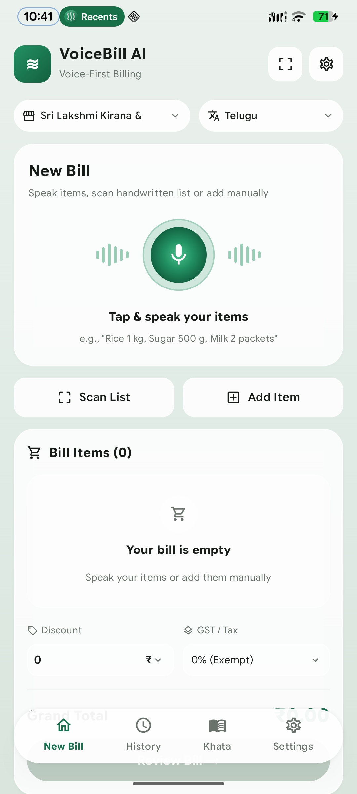
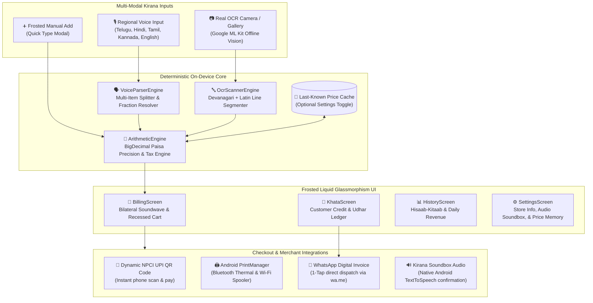

<div align="center">

# 🌿 VoiceBill AI
### *Next-Gen Voice-First & Zero-Inventory Retail Billing for Kirana Stores*

[-3DDC84?style=for-the-badge&logo=android&logoColor=white)](https://developer.android.com)
[](https://kotlinlang.org)
[](https://developer.android.com/jetpack/compose)
[](https://developers.google.com/ml-kit)
[](docs/screenshots/app_preview.jpg)
[](LICENSE)

<br/>

### 📲 Instant APK Download
Ready to test on your phone or emulator right now?

<a href="https://raw.githubusercontent.com/vitesh9876/VoiceBill-AI/main/apk/VoiceBillAI-v1.0.apk">
  
</a>
&nbsp;&nbsp;
<a href="https://github.com/vitesh9876/VoiceBill-AI/releases/tag/v1.0.0">
  
</a>

<p><em>Pre-compiled production debug APK with on-device offline Google ML Kit models bundled. Direct download hosted on raw CDN.</em></p>

---

<br/>



<br/>

```
      ıllıllı  "Rice 1 kg, Sugar 500 g, Milk 2 packets"  ıllıllı
[ 🎙️ Tap & Speak ]  ──▶  [ 🛒 Instant Bill ]  ──▶  [ 📲 Dynamic UPI QR ]
```

</div>

---

## 🌟 Overview

**VoiceBill AI** is an ultra-fast, offline-first native Android billing application created specifically for Indian grocery merchants (*kiranas*, provision stores, and supermarkets). 

Unlike heavy enterprise POS systems that demand hours of barcode cataloging and SKU entry, **VoiceBill AI requires zero upfront inventory**. Simply speak aloud in any regional Indian language, snap a photo of a customer's handwritten list, and watch the cart assemble in real-time with deterministic minor-unit (*paisa*) arithmetic.

---

## 🎯 Key Capabilities & Interactive Feature Matrix

| Feature | VoiceBill AI Native Android | Legacy Barcode POS | Manual Paper Ledger |
| :--- | :---: | :---: | :---: |
| **Speed to First Bill** | ⚡ **< 5 seconds** (Speak & bill) | ⏳ 2-3 mins (Scan SKU) | 🐌 3-5 mins (Mental math) |
| **Inventory Setup** | 🟢 **Zero Catalog Required** | 🔴 Mandatory Barcode DB | ⚪ None |
| **Regional Voice Dialects** | 🟢 **10 Indian Languages** | 🔴 None | ⚪ Merchant dependent |
| **Loose Commodity Math** | 🟢 Exact (*పావు కేజీ*, *आधा किलो*) | 🟡 Clunky Tare Scales | 🔴 Human rounding errors |
| **Handwritten Slip OCR** | 🟢 **On-Device ML Kit Vision** | 🔴 No | 🔴 No |
| **Instant UPI QR Code** | 🟢 **Dynamic per invoice** | 🟡 Static counter sticker | 🔴 Static or cash only |
| **Receipt Dispatch** | 🟢 **1-Tap WhatsApp + Thermal Print**| 🟡 Paper only | 🔴 Handwritten slip |
| **Customer Credit (Khata)**| 🟢 **Built-in with Reminders** | 🔴 Requires 3rd-party add-on | 🟡 Manual Khata book |

---

## 🎨 Interactive Architecture & Data Flow



---

## 📱 Deep Dive into Features

<details>
<summary><b>🎙️ 1. Voice-First Kirana Engine & Regional Dialects</b> (Click to expand)</summary>

* **Bilateral Soundwave Visualizers**: Real-time pulsing soundwave animations surrounding a glowing emerald microphone pill button.
* **Continuous Multi-Item Dictation**: Dictate multiple items in a single natural sentence:
  > *"Rice 2 kg 120 rupees, Sugar 500 grams 22 rupees, Aashirvaad Atta 1 packet 65"*
* **Indian Fractional Quantities**:
  * Telugu: *పావు కేజీ* (250g), *అర కేజీ* (500g), *ముప్పావు కేజీ* (750g), *ఒకటిన్నర కేజీ* (1.5kg).
  * Hindi: *पाव किलो* (250g), *आधा किलो* (500g), *सवा किलो* (1.25kg), *डेढ़ किलो* (1.5kg), *ढाई किलो* (2.5kg).
* **Operational Voice Commands**:
  * *"Clear bill"* / *"Clear all"* → Resets current cart.
  * *"Remove sugar"* / *"Delete rice"* → Selectively deletes items.
  * *"Review bill"* / *"Checkout"* → Opens instant QR & print modal.
  * *"Print bill"* → Launches system print spooler.
</details>

<details>
<summary><b>📷 2. Real On-Device OCR Scanner (Camera & Gallery)</b> (Click to expand)</summary>

* **No Hardcoded Data**: Replaces mock slips with actual **Google ML Kit Offline Text Recognition** models.
* **Multi-Script Support**: Seamlessly recognizes Latin script and Devanagari numerals/characters on handwritten paper lists.
* **Instant Line Verification**: Review scanned lines, select or deselect items, edit detected prices, and import directly into the active bill with one tap.
</details>

<details>
<summary><b>💳 3. Dynamic UPI QR Generator & Kirana Soundbox</b> (Click to expand)</summary>

* **On-Device QR Generation**: Automatically builds NPCI-compliant UPI deep-link QR codes:
  ```text
  upi://pay?pa=merchant@upi&pn=Sri+Sai+Balaji+Stores&am=185.00&cu=INR&tn=Bill+INV-1001
  ```
* **Kirana Soundbox Audio Feedback (Toggleable in Settings)**: Speaks out loud when items are added or when payments are settled in the merchant's chosen language:
  > *"VoiceBill AI: ₹185.00 bill ready for Sri Sai Balaji Stores"*
* **Last-Known Price Memory (Toggleable in Settings)**: Remembers previous rates for loose commodities and displays an unobtrusive suggestion badge (*"💡 Last sold at ₹44 [Tap to use]"*).
</details>

<details>
<summary><b>🖨️ 4. Native Thermal Printing & WhatsApp Invoicing</b> (Click to expand)</summary>

* **Hardware Thermal Printing**: Direct integration with Android's native `PrintManager` and custom `WebView` adapter. Works seamlessly with 58mm / 80mm ESC/POS Bluetooth printers, Wi-Fi network printers, or standard **Save to PDF**.
* **WhatsApp Formatted Invoice**: Creates an emoji-rich, itemized WhatsApp text receipt dispatched via `wa.me/91...` in one tap.
</details>

<details>
<summary><b>📒 5. Digital Khata (Customer Credit) & Daily Hisaab-Kitaab</b> (Click to expand)</summary>

* **Customer Credit Ledger**: Track loyal customers' *udhar* with clear outstanding balances.
* **1-Tap WhatsApp Payment Reminder**: Automatically formats and sends cordial payment reminder messages with outstanding balance details.
* **End-of-Day Sales Report**: View total daily sales volume, invoice count, and payment method breakdowns (Cash vs. UPI vs. Khata).
</details>

---

## 🛠️ Project Directory Structure

```text
Voice billing ai/
├── apk/
│   └── VoiceBillAI-v1.0.apk           # Pre-compiled sample APK for direct download
├── docs/
│   └── screenshots/
│       ├── app_preview.jpg            # Real device screenshot (Frosted Liquid Glass UI)
│       └── app_preview.png            # High-resolution device capture
├── app/
│   ├── src/main/
│   │   ├── AndroidManifest.xml        # Permissions: Camera, Audio, Bluetooth, Internet
│   │   ├── kotlin/com/example/voicebillai/
│   │   │   ├── MainActivity.kt        # Edge-to-edge entry point & frosted bottom bar
│   │   │   ├── model/
│   │   │   │   └── BillModels.kt      # BillItem, Bill, ShopSettings, KhataEntry
│   │   │   ├── engine/
│   │   │   │   ├── ArithmeticEngine.kt# BigDecimal minor-unit precision & tax math
│   │   │   │   ├── VoiceParserEngine.kt# Regional speech tokenization & fractions
│   │   │   │   ├── OcrScannerEngine.kt# Google ML Kit offline text recognizer
│   │   │   │   ├── QrCodeGenerator.kt # ZXing UPI QR bitmap engine
│   │   │   │   └── SoundboxTtsService.kt# Regional Kirana audio feedback TTS
│   │   │   ├── data/
│   │   │   │   └── VoiceBillRepository.kt# Clean SharedPreferences persistence
│   │   │   └── ui/
│   │   │       ├── VoiceBillViewModel.kt # Unified state management & coroutines
│   │   │       ├── theme/             # Color, Theme, Type (Emerald & Liquid Glass)
│   │   │       ├── components/        # GlassBackground, GlassCard, GlassPill
│   │   │       └── screens/
│   │   │           ├── BillingScreen.kt  # Screenshot-matching billing dashboard
│   │   │           ├── CheckoutModal.kt  # Dynamic UPI QR & Thermal Print spooler
│   │   │           ├── OcrScanModal.kt   # Camera / Gallery paper list scanner
│   │   │           ├── ManualItemDialog.kt# Translucent manual entry dialog
│   │   │           ├── HistoryScreen.kt  # Register summary & invoices ledger
│   │   │           ├── KhataScreen.kt    # Customer credit & WhatsApp reminder
│   │   │           └── SettingsScreen.kt # Store details & optional feature toggles
│   │   └── res/
│   │       └── drawable/              # Frosted wave launcher icons & vectors
│   └── build.gradle.kts               # Android 16 (API 36) compileSdk & ML Kit deps
├── build.gradle.kts                   # Root build configuration
├── settings.gradle.kts                # Project module definitions
└── README.md                          # Interactive project documentation
```

---

## ⚡ Quick Start: Download or Build

### Method 1: Direct Download (Sample APK)
You can directly download the sample APK file via any of the following reliable links:
* 📥 **[Direct One-Click Download (Raw CDN)](https://raw.githubusercontent.com/vitesh9876/VoiceBill-AI/main/apk/VoiceBillAI-v1.0.apk)** *(Recommended: Instant file download without GitHub router redirection)*
* 🏷️ **[GitHub Releases Page (v1.0.0)](https://github.com/vitesh9876/VoiceBill-AI/releases/tag/v1.0.0)** *(Official release notes & asset list)*
* 📦 **[View APK in Repository](https://github.com/vitesh9876/VoiceBill-AI/blob/main/apk/VoiceBillAI-v1.0.apk)** *(GitHub repository file viewer)*

#### Push to connected Android Phone / Emulator via ADB:
```bash
# Verify your device is connected
adb devices

# Install APK directly
adb install -r apk/VoiceBillAI-v1.0.apk

# Launch VoiceBill AI
adb shell am start -n com.example.voicebillai/.MainActivity
```

---

### Method 2: Build from Source

#### Prerequisites
* **JDK 17** or higher
* **Android SDK Platform 36** (API 36 / 35 compatible)
* **Android Studio Ladybug / Koala** or Gradle CLI

#### Compile Debug APK
```bash
# On Windows (PowerShell / Command Prompt)
.\gradlew.bat assembleDebug

# On macOS / Linux
chmod +x ./gradlew
./gradlew assembleDebug
```
The newly compiled APK will be generated at:
`app/build/outputs/apk/debug/app-debug.apk`

---

## 🔒 Privacy & Offline Commitment

* **100% On-Device Processing**: Voice parsing, calculations, and Google ML Kit OCR run entirely on your smartphone hardware.
* **No Cloud Dependency**: No remote servers or third-party cloud APIs are contacted during daily billing operations.
* **No Forced Subscriptions**: Stores merchant data and history safely in local private device storage.

---

## 📜 License

This project is licensed under the **MIT License** — feel free to customize, distribute, and enhance for retail merchants worldwide.

<div align="center">
  <sub>Built with ❤️ for Indian Kirana Stores & Small Retailers.</sub>
</div>
